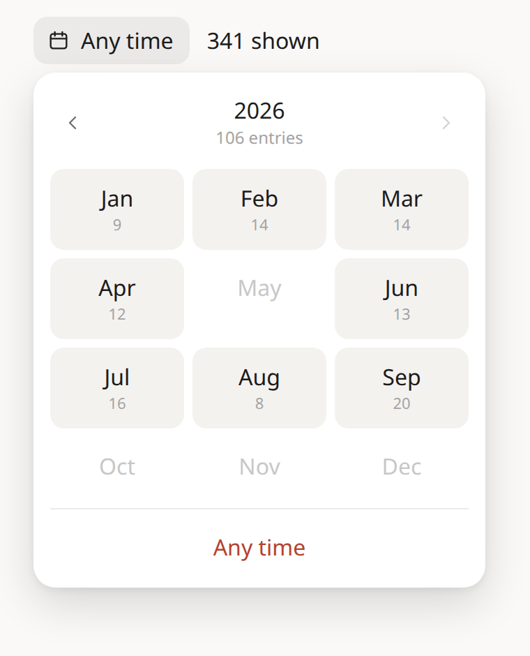
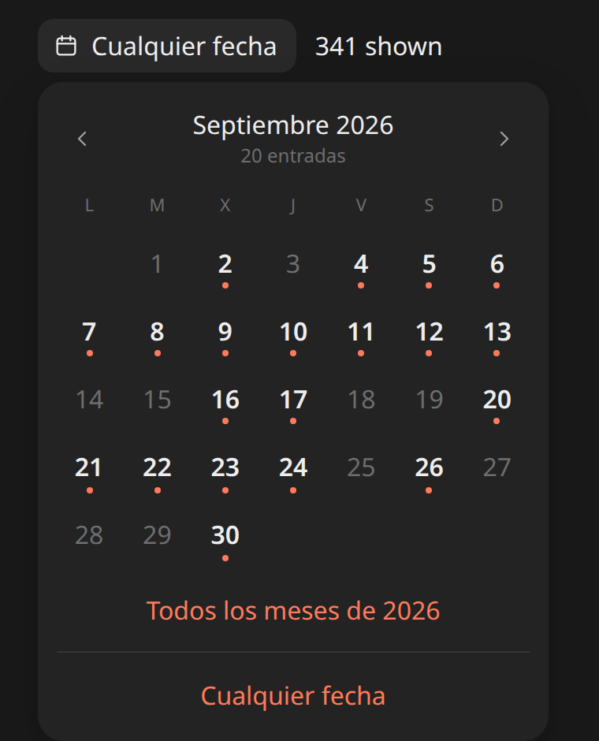
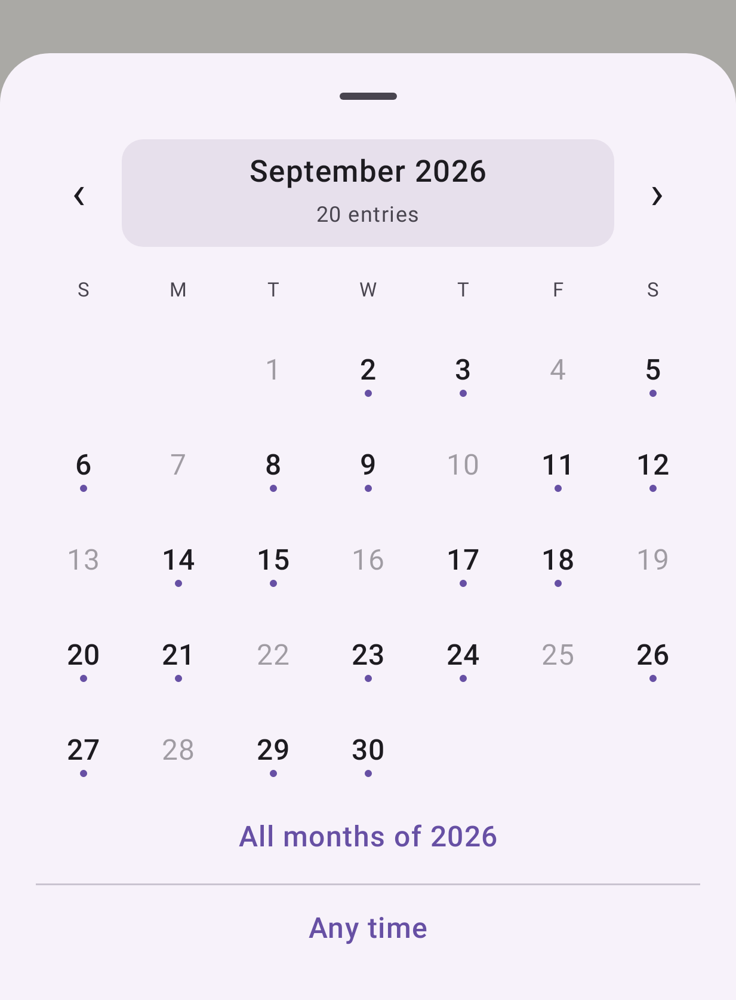

# calendar-filter

A date filter that stays the same size however many years of data you have.

A dropdown that lists every month grows without end: after five years of a journal it is sixty rows long. This opens on **one year as twelve months with counts**. Tap a month to see **its days, with a dot on each day that has something**. Pick a whole year, a month or a single day; arrows move between years and months.

| Web, light | Web, dark (Spanish) | Android |
|---|---|---|
|  |  |  |

Two drop-in files, no dependencies beyond the framework:

- **Web:** [`web/CalendarFilter.jsx`](web/CalendarFilter.jsx) and [`web/calendar-filter.css`](web/calendar-filter.css) for Preact (for React, import the hooks from `react`).
- **Android:** [`android/CalendarFilterSheet.kt`](android/CalendarFilterSheet.kt), a Jetpack Compose Material 3 bottom sheet.

Both are copied from [Sello](https://sello.voypalante.com), a private journal, where they filter entries.

## Web

```jsx
import { CalendarFilter, LABELS_ES, dayKey } from './CalendarFilter.jsx';
import './calendar-filter.css';

const counts = new Map();
for (const p of posts) counts.set(dayKey(p.date), (counts.get(dayKey(p.date)) ?? 0) + 1);

const [when, setWhen] = useState(''); // '' | 'YYYY' | 'YYYY-MM' | 'YYYY-MM-DD'
const shown = posts.filter((p) => !when || dayKey(p.date).startsWith(when));

<CalendarFilter counts={counts} value={when} onChange={setWhen} locale="es" labels={LABELS_ES} />
```

| Prop | |
|---|---|
| `counts` | `Map` of `"YYYY-MM-DD"` to how many items that day. Build keys with `dayKey(date)` (local time) |
| `value`, `onChange` | The selection: `''`, a year, a month or a day, as a key prefix |
| `locale` | For month and weekday names (`Intl.DateTimeFormat`). Default `en` |
| `labels` | Button and count texts. `LABELS_EN` and `LABELS_ES` are included |
| `firstDay` | 0 for Sunday, 1 for Monday. Default: from the locale |

Colors are CSS custom properties on `.cf` (`--cf-accent`, `--cf-surface`, and so on), with a dark set under `prefers-color-scheme`. The popover closes on outside click and Escape, and keeps the same size on phones.

Try it: `cd demo && npm install && npm run dev`.

## Android

```kotlin
val counts = remember(items) { items.groupingBy { dayKey(it.time) }.eachCount() }
var selected by remember { mutableStateOf<String?>(null) }
var open by remember { mutableStateOf(false) }

if (open) CalendarFilterSheet(counts, selected, onPick = { selected = it; open = false }, onDismiss = { open = false })
val shown = items.filter { selected == null || dayKey(it.time).startsWith(selected!!) }
```

It uses `MaterialTheme.colorScheme`; pass `accent` for the dots and links, and `labels = CalendarFilterLabels.Spanish` or your own. `calendarFilterLabel(value)` gives button text like "October 2026". Needs API 24+ (`android.icu`) and Compose Material 3. Change the `package` line to yours.

## License

MIT
